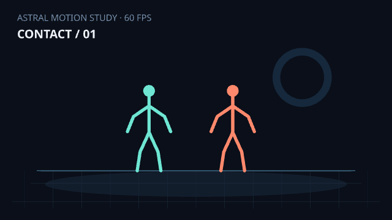
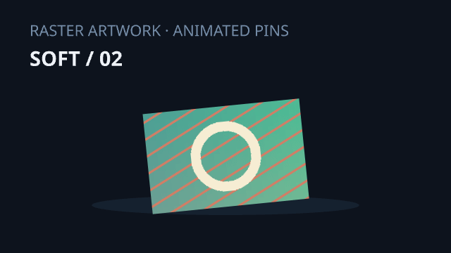
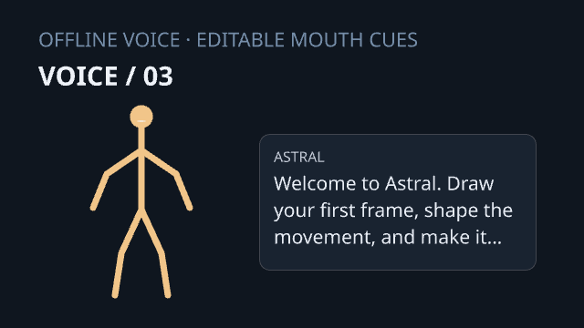
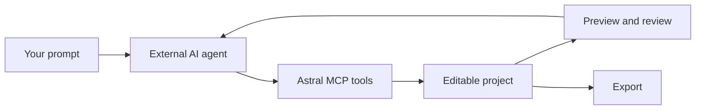

<p align="center"></p>
<h1 align="center">Astral</h1>
<p align="center">A native animation studio for hands-on animators and AI coding agents.</p>
<p align="center">
  <a href="https://github.com/nqtexd/astral/releases"></a>
  
  <a href="COPYING"></a>
  <a href="AI_PROVENANCE.md"></a>
</p>

**Draw it yourself, animate a rig, or ask an external agent to work through MCP. Everything stays editable.**

[Download v0.13.0](https://github.com/nqtexd/astral/releases/tag/v0.13.0) · [Quick start](#getting-started) · [MCP setup](#animate-with-mcp) · [Features](#features) · [Changelog](docs/ASTRAL-CHANGELOG.md) · [Licenses](THIRD_PARTY_NOTICES.md)

> **Early access · Windows 11 x64.** This is a native Windows release, not Moho Debut parity or a finished cross-platform product. Android has an earlier development preview. Apple build sources exist but are unverified on Apple hardware. See [platform readiness](docs/ASTRAL-RELEASE-READINESS.md).

## Watch, open, make it yours

Actual Astral renders. The source projects stay editable—poses, raster pins, captions, mouth cues and audio tracks.



| Raster deformation | Offline voice and mouth cues |
| --- | --- |
|  |  |

[Download the editable tester scenes](https://github.com/nqtexd/astral/releases/download/v0.13.0/Astral-0.13.0-showcase.zip) · [Open the projects and testing guide](docs/showcase/README.md) · [Reproduce the renders](crates/astral/examples/showcase.rs)

GIFs are silent, 24 FPS previews. The fight project runs at 60 FPS and includes separate impact clips. These are tool demonstrations made with AI coding assistance; they do not promise automatic film-quality acting.

## Getting started

1. Download **Astral-0.13.0-windows-x64.zip** from [Releases](https://github.com/nqtexd/astral/releases/tag/v0.13.0).
2. Extract the whole ZIP to a writable folder. Keep its executables, models and notices together.
3. Run **Astral-Studio.exe**. `astral.exe` is the separate command-line/MCP executable.
4. Choose **New project**, set the canvas, FPS and duration, then create it.
5. Draw on frame 1, then select frame 2 for a different drawing. Independent single-frame drawing is the default; onion skins are previews, not copied ink. Use exposure controls for holds.
6. Save your `.astral` project and reopen it from the library or file picker.

Manual editing needs no account or paid generation service. An external AI client may have its own account, network and pricing requirements.

### Video export

PNG previews work immediately. Video export, media conversion and shot assembly need a **separately installed FFmpeg**. The public ZIP does not redistribute an encoder binary.

Get FFmpeg through the [official download page](https://ffmpeg.org/download.html), extract it, then choose **Settings → Appearance → Video encoder → Select FFmpeg executable**. Alternatively, use `PATH` or `ASTRAL_FFMPEG`. Standard MP4 uses `libx264`; supported hardware encoders are tried at runtime with software fallback. A separately acquired encoder retains its own licenses and distribution requirements.

## Features

| Workspace | What it includes |
| --- | --- |
| Projects | Create/open/save/Save As, favorites, search, name/date sorting, edited/opened times, revision numbers, rename, restorable Trash and a local change log. |
| Draw | Vector strokes, layers, independent cels, holds, blank frames, onion skins, frame copying, bulk operations and reversible completion suggestions. |
| Artwork | PNG/JPEG/WebP/BMP images, ordered image sequences, bounded video-frame import, 8-bit RGB PSD layers, independent bitmap painting, transform keys and animated deformation pins. |
| Rig & animate | Named joints, hand/foot IK, bone constraints, pose mirroring/libraries, action clips, foot contacts, paths, easing and opt-in Flow interpolation and reviewed motion-polish proposals. |
| Motion studio | Editable walk/run/jump/strike presets, fight-beat proposals, motion brush, retiming, coaching and original/proposed previews. |
| Storyboard | Cast, rig assignments, shot ranges, action intent, locations, entry/exit states, camera/audio intent and continuity notes. |
| Dialogue & graphics | Editable captions and speech/thought bubbles, typewriter text, font styling, border/corner/color controls, clouds, shapes, vector contours and lower thirds. |
| Effects & camera | Impact packs, flashes, trails, particles, dust/smoke/sparks, glow/blur, shake and camera keys. Presets vary in sophistication. |
| Audio | WAV clips, waveforms, gain, trims, fades, loops/mixing and offline Windows text-to-speech, user-initiated microphone recording and editable sound-energy/text-guided mouth cues. |
| Review | Contact/prop/doorway checks, torso spacing, continuity, layout warnings including raster bounds, shaped-text overflow detection, and fit/placement proposals. These are heuristics, not visual-quality guarantees. |
| Export & finish | Instagram Reels/Stories/feed, YouTube/Shorts and TikTok presets; MP4, WebM, GIF, PNG, JPEG, PNG-sequence ZIP and WAV. Choose CPU or physical wgpu GPU rendering; assemble shots with trims and synchronized audio. |
| Customize | Accents, canvas surround, corners, compact controls, stronger contrast, scale, reduced motion, panels, grid, frame-card size and recovery/drawing defaults. |
| Agents | MCP over stdio, typed commands, revision checks, atomic batches, undo/redo, previews, jobs and cancellation. Live MCP and GUI share the document service. |

[Artwork, recording and GPU workflow](docs/ASTRAL-ARTWORK.md) · [Project/customization guide](docs/ASTRAL-PROJECTS.md) · [Motion, composition and finishing](docs/ASTRAL-FEEDBACK-FIXES.md)

### Project library

Use a card's **…** menu to rename its title, inspect changes or move it to Trash. Renaming keeps the filename stable. Trash saves current edits, closes the document and moves its `.astral` file into `.astral-trash` beside the original. Linked media stays in place. **Trash → Restore** refuses to overwrite an existing file.

**Refresh** updates cached metadata. “Edited” uses file modification time; “Opened” is separate. The local change log keeps the last 200 edits and changed sections. It is not full version control or a snapshot diff. Recovery files are separate from manual saves; keep backups.

### Animation assistance, honestly

The small trained pose-completion model and example-based motion/stroke interpolation are documented in the [model card](models/MODEL_CARD.md), including synthetic training data and limits. Stickman recognition targets one clear line figure with reviewed landmarks, not arbitrary photos or complex artwork.

`auto_animate` creates a bounded seeded two-character spar, inspects scenes, proposes limited repairs or continues compatible grounded motion. It is **not** a general text-to-film model. An external agent supplies creative decisions and reviews results. Acting, weight and production quality still need iteration.

## Animate with MCP

MCP lets an external coding agent control Astral. No separate chat model is hidden in the app.



Open **Astral-Studio.exe** and leave it running. **Settings → Agents → Copy MCP configuration** generates paths for your PC; paste it into your client's local/stdio server settings. Or edit [mcp.example.json](mcp.example.json):

```json
{
  "mcpServers": {
    "astral": {
      "command": "C:/Apps/Astral/astral.exe",
      "args": ["--workspace", "C:/Users/YOU/Documents/Astral", "mcp"]
    }
  }
}
```

Replace both paths. Editor and MCP must use the **same workspace**. To choose one explicitly:

```powershell
.\Astral-Studio.exe --workspace C:/AstralProjects
```

Use that workspace in the MCP arguments. Enable/restart the server in the client. Use `astral.exe`, not the GUI launcher. The client starts the stdio process; opening a terminal alone does not connect an agent.

### Try a prompt

> Use Astral MCP to create a six-second, two-character stickman spar at 24 FPS. Plan a storyboard first. Add anticipation, contact and recovery poses, keep feet grounded, leave space for editable captions, and add an impact and separate sound cue. Render previews, review contacts and layout with step 1, and save the editable project. Inspect moving previews before final export.

The agent should discover tools, inspect IDs/rigs/revisions, plan, propose/edit, review previews, refine, save and export. Mutations use `expected_revision`; stale revisions reject edits and invalid batches commit nothing. Poll `job_status` for exports.

Tools include `create_managed_project`, `draw_frame`, `animate_character`, `motion_tools`, `storyboard`, `add_dialogue`, `add_voice`, `render_preview`, `review_animation`, `assemble_video`, `project_activity`, `rename_project`, `trash_project`, `save_project` and `history`. Discover current schemas rather than guessing fields.

**Headless:** add `--headless` after `mcp` for a separate session. It does not automatically share editor state. Profiles: `all`, `projects`, `animation`.

[Agent guide](docs/ASTRAL-AGENTS.md) · [Manual frames/Auto Animate](docs/ASTRAL-AUTO-ANIMATE.md) · [Storyboard/contacts](docs/ASTRAL-STORYBOARD.md) · [Exports](docs/ASTRAL-EXPORTS.md)

## Made with AI

**Astral's Rust rebuild and additions were developed with AI coding agents under nqtexd's direction.** AI assisted implementation, debugging, tests and documentation. This derivative of StykAnimate retains upstream attribution; the disclosure does not claim every original line was AI-generated. See [AI provenance](AI_PROVENANCE.md) and [credits](CREDITS.md).

Automated checks do not replace human review, security review or artistic judgment.

## Build from source

Windows prerequisites: Rust **1.95+**, MSVC C++ tools and a graphics driver. Python 3.12+ supports packaging/temporary legacy codecs. Node 24 runs agent acceptance scripts. Install FFmpeg separately for media checks.

```powershell
git clone https://github.com/nqtexd/astral.git
cd astral
cargo build -p astral --release --locked
cargo run -p astral -- --workspace C:/AstralProjects studio
```

`target/release/astral-studio.exe` is the launcher; `target/release/astral.exe` is CLI/MCP.

```powershell
cargo test --workspace --locked
cargo fmt --all -- --check
node scripts/check-astral-feedback.mjs
powershell -File scripts/package-astral.ps1 -SkipBuild
```

Packages include dependency notices and omit encoder binaries by default. Caches, private projects, generated films and old archives stay out of Git. Retained Electron/web sources are upstream compatibility code; Astral's executable is Rust. [Platform build notes](docs/ASTRAL-RELEASE-READINESS.md).

## Current limits

- Windows early access; physical Android checks and Apple builds/signing are unfinished.
- Full Moho Debut parity remains unfinished. Basic raster/PSD, deformation pins, capture, mouth cues and local tracking are now available; advanced deformation, pressure brushes, correctives, localization and other gaps remain.
- Legacy imports retain originals and convert supported authored lines/circles into editable drawing cels. Source rig semantics, tweens, custom shapes, camera, media and effects are not equivalent.
- Use Artwork import to render images/sequences. Registering an asset alone does not place it on stage. Video is extracted into bounded image sequences, with separate audio import; PSD masks, text, blend groups and unsupported compression are reported.
- Auto export uses a physical GPU for raster projects when initialization succeeds, otherwise bounded CPU rendering; light vector scenes default to CPU. Explicit GPU mode reports adapter/readback metrics. Hardware encoding remains separate. Speed depends on the scene and hardware.
- Review tools cannot certify composition, continuity or realistic acting.
- The release is unsigned; it is not a store-signed installer.

## License and credits

**GPL-3.0-or-later.** See [COPYING](COPYING), [CREDITS.md](CREDITS.md) and [THIRD_PARTY_NOTICES.md](THIRD_PARTY_NOTICES.md). Original StykAnimate attribution remains. Dependencies, fonts and separate encoders keep their licenses. This is not a proprietary relicense or a claim over third-party content.

## Contribute

[Report a problem](https://github.com/nqtexd/astral/issues) with version, Windows/GPU, canvas/FPS, frame range and reproduction steps. Include job/encoder metrics for export issues. Small projects and short previews help; remove private media first. [Contributing guide](CONTRIBUTING.md).

**Topics:** `animation` · `stickman` · `rust` · `egui` · `wgpu` · `mcp` · `frame-by-frame` · `ai-built` · `ai-assisted` · `offline` · `windows` · `open-source`
